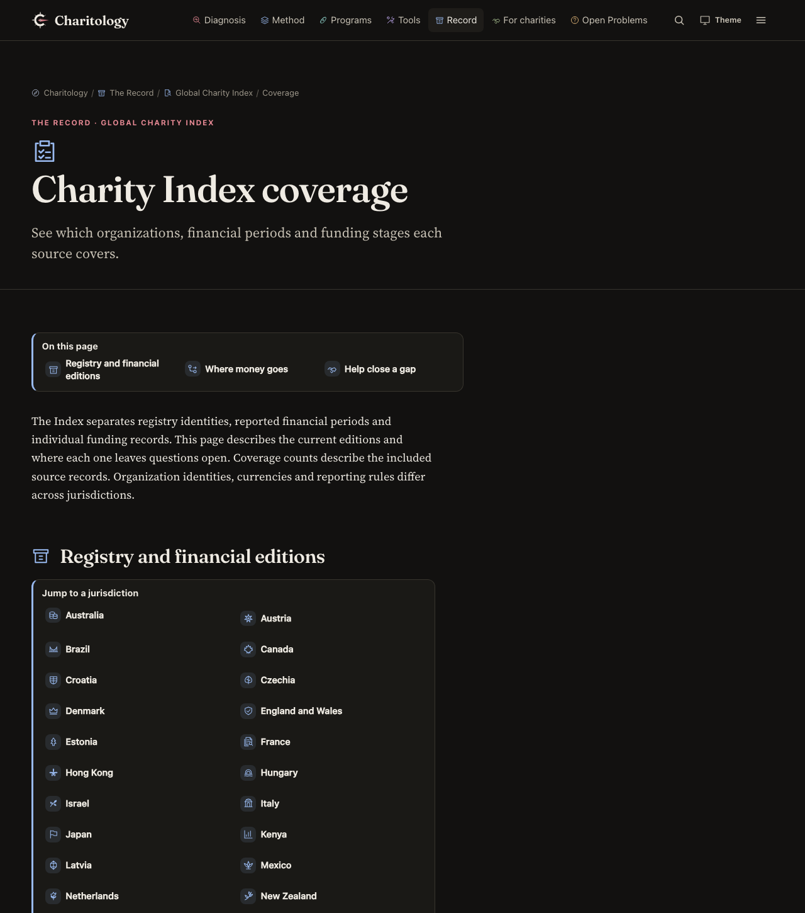
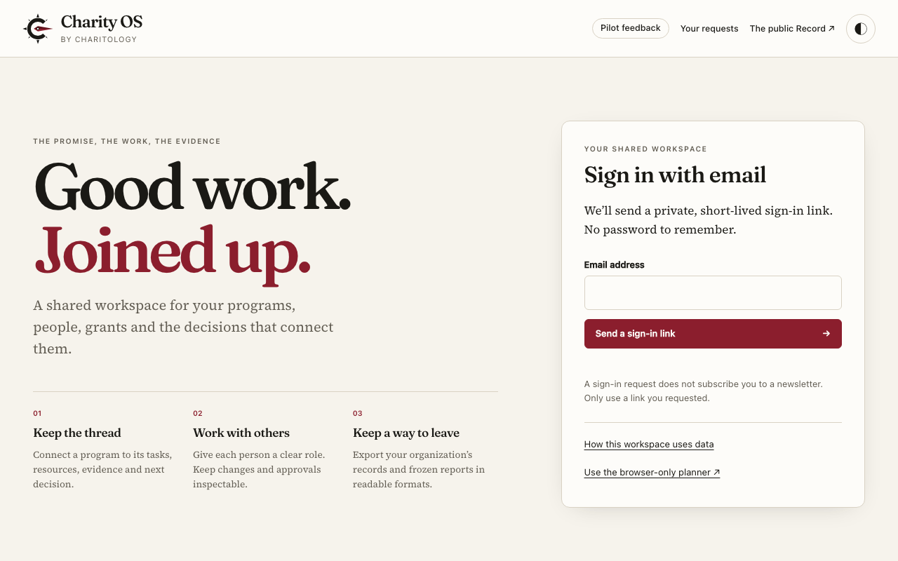
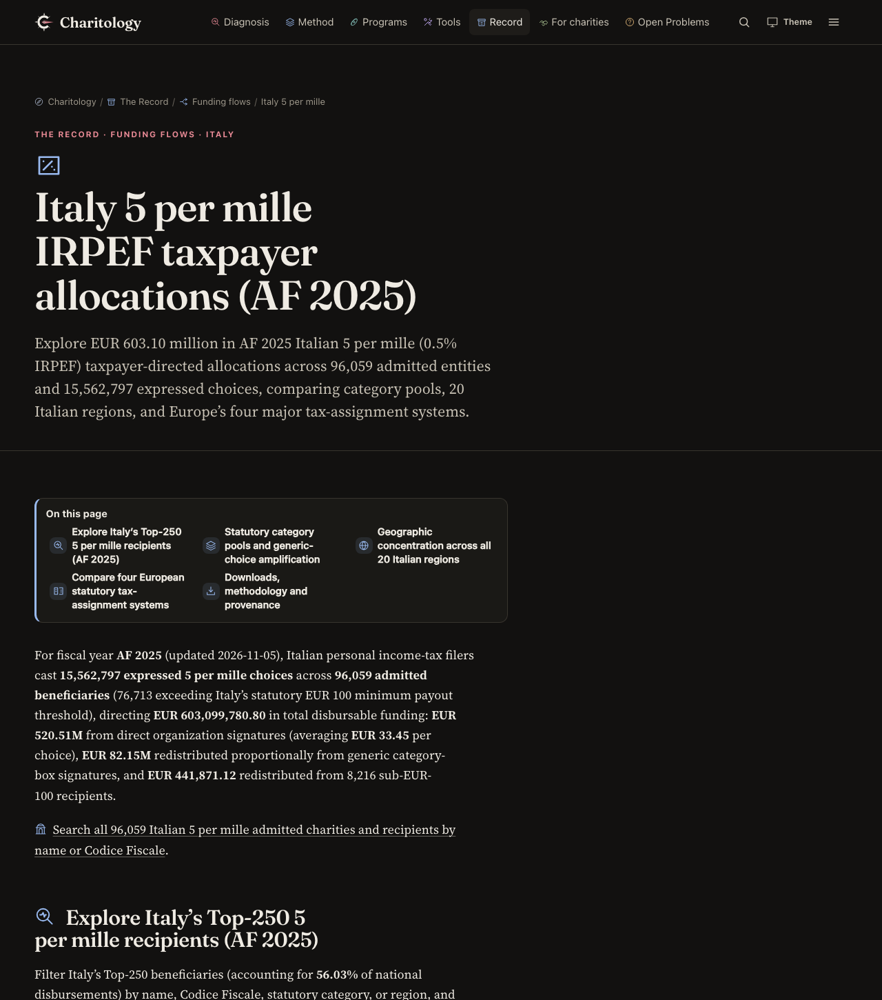

# Charitology

[](https://glama.ai/mcp/connectors/io.github.theguysaccount/charitology)

**The science of doing the most good.** An open field that studies charity as a system: where generosity flows, why it flows there, and how to route it from the symptoms of the world’s problems to their sources.

Giving USA estimates that [U.S. charitable giving reached $617.2 billion in 2025](https://givingusa.org/giving-usa-charitable-giving-rose-to-617-20-billion-in-2025-surpassing-the-600-billion-mark-for-the-first-time/). Charitology proposes a shared craft for studying the signals, channels, incentives and feedback that aim generosity. It connects existing work in philanthropy, ethics and evaluation across causes and moral frameworks. Its own causal claims remain hypotheses to test.

## Visual tour

| Global Charity Index (31 jurisdictions · 3.34M records) | Charity OS (`os.charitology.org`) |
| --- | --- |
| [](https://charitology.com/record/charity-index/coverage/) | [](https://os.charitology.org/) |
| **Austria BMF tax-deductible charities (`§ 4a EStG`, 8,577 records)** | **Italy 5 per mille IRPEF allocations (EUR 603.10M · 96,059 entities)** |
| [](https://charitology.com/record/charity-index/austria/) | [](https://charitology.com/record/funding-flows/italy-five-per-mille/) |

## What’s here

|                                                |                                                                                                                                                                                                   |
| ---------------------------------------------- | ------------------------------------------------------------------------------------------------------------------------------------------------------------------------------------------------- |
| **[Global Charity Index](https://charitology.com/record/charity-index/coverage/)** | **31 jurisdictions** (`3,338,544` dated official registry records across five continents, filterable by region and data type) preserving original legal forms, native currencies, explicit `null` vs. `0`, and SHA-256 provenance manifests — no charity ratings or overhead scores. |
| **[Funding Flows](https://charitology.com/record/funding-flows/)** | **48 public funding-flow lookups and case studies**, including the **5-Country European Tax-Assignment Observatory** (Italy `5‰`, Poland `1.5%`, Slovakia `2%/3%`, Hungary `1%+1%`, Slovenia `1%`), the **EU Transparency Register Civil Society & EUR 7.80B EU Grants Explorer** (`6,317` orgs across `106` HQ countries), UN OCHA FTS Global Humanitarian Funding Gaps (`2019–2026`), and OpenFEMA `2024–2026` disaster captures. |
| **[The Diagnosis](src/content/conditions/)**   | Fifteen conditions of the charity system, each labeled established, documented, debated or hypothesis. No judgment of the good being done; the system is the subject.                             |
| **[The Method](src/pages/method.astro)**       | Nine instruments a charitologist uses, from the five-level depth scale (relief → repair → prevention → structure → source) to the Giver’s Checklist.                                              |
| **[The Open Problems](src/content/problems/)** | Twenty-three unanswered questions, Hilbert-style, each with a test for what counts as progress.                                                                                                   |
| **[Programs](src/content/programs/)**          | 26 programs have usable browser functions. Institutional operations still need people, resources and governance. Each page states its exact scope.                                                |
| **[Tools](src/content/tools/)**                | 20 catalog tools, including [Charity OS](https://os.charitology.org/), Charity Lookup, Due Diligence Checklist, Values Compass, Portfolio Builder, Compare Tool, Grant Evaluator, Impact Calculator, Cost-Effectiveness Model Kit, Giving Dashboard, and Forecasting Platform. |
| **[Free Things for Charities](https://charitology.com/for-charities/free/)** | **65 verified** free software donations, cloud and ad grants, AI discounts, zero-fee fundraising tools, and pro bono legal networks for nonprofits, with open CC BY 4.0 JSON/CSV downloads ([`/data/free-charity-resources.json`](https://charitology.com/data/free-charity-resources.json)). |
| **[MCP Server & Agent Access](https://os.charitology.org/mcp.html)** | Read-only public Streamable HTTP MCP server at `https://os.charitology.org/mcp` (listed on [Glama](https://glama.ai/mcp/connectors/io.github.theguysaccount/charitology)), `/.well-known/mcp.json`, and [`/llms.txt`](https://charitology.com/llms.txt) for Claude, ChatGPT, Codex, and Cursor. |
| **[The Record](src/content/record/)**          | 21 information bases: Encyclopedia, Intervention Database, Cause Atlas, Gap Map, Failure Archive, Disagreement Register, Principles textbook (with all 10 computer-narrated podcast chapters), Lexicon and more. |
| **[Public API](src/lib/api.ts)**               | 42 static JSON datasets at `/api/v1/*.json` (including `/api/v1/charity-index.json` and `/api/v1/funding-flows.json`), with exact factual source/edition pins and source-specific reuse terms. |
| **[Browser extension](extension/)**            | *Before You Give* (`v0.2.0`): the Giver’s Checklist on supported donation pages, without analytics or background data transmission.                                                              |

Every page follows [the Charitology Standard](STYLE.md): a source for every factual claim, honest evidence labels, unknowns left unknown, and no ratings of named charities until a rating method has survived public red-team review.

**[All 31 formerly seeded/designed items now have implemented software or published editions](docs/IMPLEMENTATION_NOTES.md)**, including the self-paced course, research desks, 217 country/economy data profiles, reference workbenches and all 10 computer-narrated podcast chapters. The [full roadmap](https://charitology.com/roadmap/) preserves every original idea and its current boundaries.

**Public review and provenance:** All sources, datasets, and claims are open to public verification, corrections, and independent human review ([how review works](https://charitology.com/contribute/review/), [Issue #1](https://github.com/theguysaccount/charitology/issues/1)). The [public research ledger](https://charitology.com/research-ledger/) preserves exact sources, revisions and qualification limits.

## Run it

Node 22.23.4 or newer; `.nvmrc` selects Node 24. The live site runs on Astro 7.4.7 (see the [Astro 7 migration record](docs/ASTRO_7_MIGRATION_ACCEPTANCE.md)).

```sh
npm ci
npm run dev      # http://localhost:4321, live reload
npm run build    # static site in dist/, with the search index and extension zip
npm run check    # content cross-references and every internal link
npm run preview  # serve dist/ (search works here, not in dev)
```

The public site is static HTML with browser-local TypeScript workspaces and requires no keys or database to build. Separate services run [newsletter delivery](services/newsletter/README.md) and the [shared Charity OS](services/charity-os/README.md); their private configuration is not part of the public build.

The shared OS at https://os.charitology.org includes [approved public request forms](docs/PUBLIC_PARTICIPATION.md), an [own-request portal](docs/PARTICIPANT_PORTAL.md), [confirmed participation and manual waitlists](docs/PARTICIPATION_BOOKINGS.md), [separately consented email notices](docs/PARTICIPATION_DELIVERY.md) and [immutable grant-period reports](docs/GRANT_REPORTS.md). The linked records distinguish automated checks, controlled browser/inbox evidence and remaining real-pilot and independent-review gates. Money movement and sensitive case narratives remain outside its scope.

The [study register](docs/STUDY_REGISTER.md) connects the Evidence Library and Evidence Reviews in one browser-local workspace: citation imports, frozen protocols, recorded screening decisions, retrieval/extraction inputs, flow counts and guarded backups. Local labels and hashes establish no independent reviewer or performed study.

The [research ledger](docs/RESEARCH_LEDGER_ACCEPTANCE.md) connects the 23 Open Problems, journal manuscripts, historical cases and methodology to pinned source versions and public correction history. Its initial capture contains one editorial correction affecting two claims, with no qualifying research result or independent review. It preserves unknown historical baselines and adds complete edition JSON/CSV and inert source downloads.

## How it’s built

- [Astro](https://astro.build) 7.4.7 with content collections. Every collection is validated by a schema in [`src/content.config.ts`](src/content.config.ts), so a malformed entry fails the build.
- Content is Markdown with YAML front matter in `src/content/`. Shared data (causes, moral frameworks, the depth scale, the checklist, headline figures with sources) is JSON in `src/data/`.
- Tools are plain TypeScript in `src/components/tools/`, with a small shared kit in `src/lib/client/`. Browser-local tools keep their records on the device; the shared OS uses its own authenticated API and private database.
- Search is [Pagefind](https://pagefind.app), built at deploy time.
- `npm run check` runs content, link, media, extension, original-brief, model, reference-export and publication TypeScript checks in CI on every pull request.

## Deploy

Pushing to `main` deploys to GitHub Pages through [`.github/workflows/deploy.yml`](.github/workflows/deploy.yml). The workflow reads the Pages address, so the same build works at `https://<owner>.github.io/charitology/` or on a custom domain such as `charitology.org`. To use a custom domain, set it in the repository’s Pages settings and point the domain’s DNS at GitHub Pages.

## Contribute

Anyone can become a charitologist. Fix a fact, write an entry, take on an open problem, improve a tool, or red-team a claim. Start with [CONTRIBUTING.md](CONTRIBUTING.md).

## Related open instruments

Charitology links independent open projects that already measure parts of the system:

- [Humanity’s Checklist](https://humanityschecklist.org/): six proposed sources linked to world problems; Charitology treats its causal map as a hypothesis
- [Systemic Altruism](https://charities.systemicaltruism.com/): an evidence tracker for structural change
- [Charity Impact Media](https://theguysaccount.github.io/charity-impact-media/): sourced Form 990 spending for about 25,000 U.S. charities
- [WHOFUNDS](https://theguysaccount.github.io/whofunds-open-grant-graph/): the open grant graph of U.S. private foundations

## License

Code: [MIT](LICENSE). Content and data: [CC BY 4.0](CONTENT-LICENSE.md). Cite as “Charitology (charitology.org)”. Cited sources keep their own rights. The IRS identity snapshot retains its government-source attribution and provenance; the content license does not relicense third-party source records.
